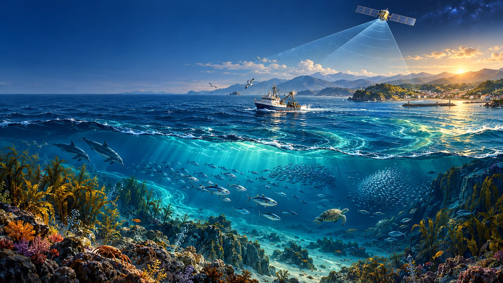
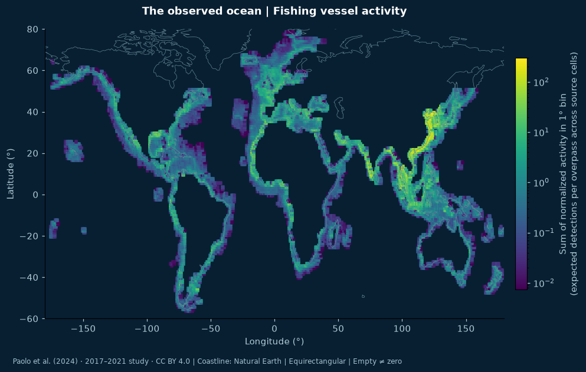
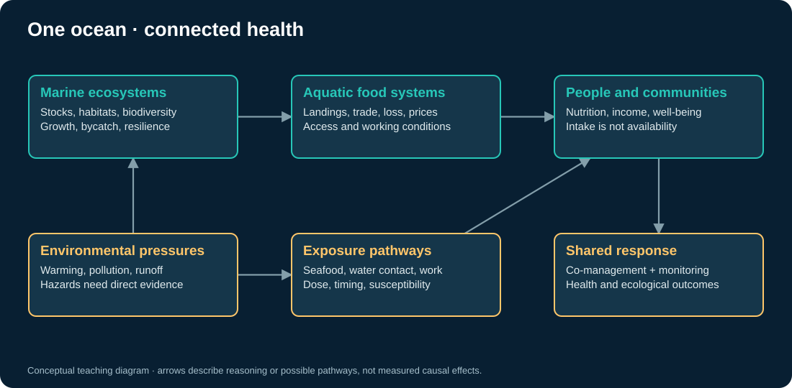

# Ocean Watch · Fishing, Dark Vessels & One Health



**See the fishing. Question the invisible. Connect the consequences.**

A visual Jupyter Book and browser-based Python laboratory exploring Global Fishing Watch, dark vessels, satellite radar, fisheries, ecosystem health and population health through a One Health lens.

[**Read the book ↗**](https://jltobias.github.io/JupyterLite-Global-Fishing-Watch-and-Dark-Vessels/) · [**Launch JupyterLite Lab ↗**](https://jltobias.github.io/JupyterLite-Global-Fishing-Watch-and-Dark-Vessels/lab/index.html?path=01_observed_ocean.ipynb) · [**Explore Global Fishing Watch ↗**](https://globalfishingwatch.org/map/) · [Sources & attribution](content/sources.md)

[](https://github.com/jltobias/JupyterLite-Global-Fishing-Watch-and-Dark-Vessels/actions/workflows/deploy.yml)

The book and lab links are the GitHub Pages deployment targets. They become available after Pages is configured for **GitHub Actions** and the deployment workflow succeeds. No installation or account is needed for the bundled lab exercises. First use downloads the browser Python runtime and packages; this is not a fully offline distribution.

## Explore the ocean from evidence to action



*Historical observations, modeled classification.* Map colors show sums of per-overpass normalized activity in 1° bins, not fishing hours, catch, or unique vessels. Source: [Paolo et al. (2024), analysis data](https://doi.org/10.6084/m9.figshare.24309475), CC BY 4.0. Coastline: Natural Earth, public domain.

| Notebook | What you can investigate | Evidence |
|---|---|---|
| [01 · Observed ocean](content/01_observed_ocean.ipynb) | 2D maps, coverage, denominators, matched and unmatched activity | Published GFW/Sentinel-1 study, 2017–2021 |
| [02 · Ocean in 3D](content/02_ocean_in_3d.ipynb) | Rotate a globe; inspect a satellite-to-ecosystem scene | Observed map + separately labeled conceptual scene |
| [03 · Matching and uncertainty](content/03_matching_and_uncertainty.ipynb) | Change AIS–SAR time/distance gates and identity assignments | Synthetic positions |
| [04 · SAR detection](content/04_sar_detection.ipynb) | Inspect actual radar pixels; explore speckle, false alarms, precision/recall and a 3D intensity surface | Real Sentinel-1 crop + separate synthetic detector experiment |
| [05 · Satellite catalog](content/05_satellite_catalog.ipynb) | Inspect acquisitions and optionally query a live STAC catalog | Saved real metadata; optional public live search |
| [06 · Environment and health](content/06_environment_and_health.ipynb) | Inspect temperature and uncertainty; investigate seasonality and confounding | NOAA OISST analysis + separate synthetic series |
| [07 · Food and equity](content/07_food_and_equity.ipynb) | Follow seafood retention, edible yield, loss and unequal access | Explicit food-system scenarios |
| [08 · Fish stocks](content/08_fish_stocks.ipynb) | Compare denominators and experiment with stock resilience | Attributed FAO summary + hypothetical biomass model |
| [09 · GFW workbench](content/09_gfw_workbench.ipynb) | Validate and map your own downloaded apparent-fishing CSV | Synthetic schema example until you supply an export |

The book also includes infographics, regional study designs for Northern Europe, West Africa and the Eastern Pacific, an evidence-brief capstone, and a provenance guide. Core exercises contain no secrets and do not require authenticated API calls. The optional [local SAR extraction script](scripts/fetch_sar_window.py) reads bounded calibrated windows rather than loading full scenes.

## Why One Health?

Fishing connects marine ecosystems, aquatic foods, livelihoods, working conditions and environmental exposure. The book asks how these pathways could affect population health, and which measurements each inference requires. It addresses nutrition and food access, contaminants, climate-sensitive coastal hazards, ecosystem resilience, animal populations and sustainable stocks. [WHO One Health framing](https://www.who.int/publications/m/item/one-health-definitions-and-principles).



**An unmatched detection is not proof of illegal fishing.** AIS gaps can have many causes. Activity maps do not directly measure catch, stock abundance, individual dietary intake, contaminants or disease. Synthetic scenarios are labeled in notebook text and figure titles. The [ICEYE article](https://www.iceye.com/blog/dark-vessels-in-northern-europe-and-how-iceyes-satellites-find-them) motivates the commercial-SAR discussion; no ICEYE imagery or detections are redistributed.

## Build and preview locally

Use Python 3.12. Commands below work on macOS/Linux; on Windows replace `.venv/bin/python` with `.venv\Scripts\python`.

```bash
python -m venv .venv
.venv/bin/python -m pip install -r requirements.txt
.venv/bin/python -m unittest discover -s tests -v
.venv/bin/python scripts/build_site.py --execute
.venv/bin/python scripts/validate_site.py
.venv/bin/python -m http.server 8000 --directory _site
```

Open `http://localhost:8000/` for the book or `http://localhost:8000/lab/index.html` for the lab. The pinned Jupyter Book 1/Sphinx renderer is in maintenance mode; see [methods](content/methods.md) for the build choice. Live search is disabled in ordinary execution, and normal builds do not refresh source data.

To author or refresh outputs:

```bash
.venv/bin/python scripts/create_notebooks.py
.venv/bin/python scripts/execute_notebooks.py
.venv/bin/python scripts/create_visuals.py
```

`create_notebooks.py` regenerates notebook sources and clears their outputs; export any interactive edits you want to keep. Use `--only 06_environment_and_health`, for example, to regenerate one. Public input refresh is explicit: run `fetch_public_data.py`, `fetch_context.py`, `fetch_environment.py`, and `prepare_data.py`. The real SAR crop can be refreshed separately after installing `requirements-eo.txt`; it requires network access and records provenance.

## Publish with GitHub Pages

1. Push this repository to the `main` branch.
2. In **Settings → Pages → Build and deployment → Source**, choose **GitHub Actions**.
3. Run **Build and deploy Ocean Watch** or push a change. The workflow verifies data/model invariants, executes all nine notebooks, builds the book and lab, checks local links, and deploys one Pages artifact.
4. Open the book and lab links above after the deployment is green. Pull requests build and validate without publishing.

JupyterLite stores edits in the browser. Download notebooks before clearing site data or changing browsers. The published book and lab vendor Plotly JavaScript; exported notebooks in a separate desktop Jupyter environment use a CDN. WebGL is needed for 3D plots, with 2D companion views available. See [getting started](content/getting-started.md) for details.

## Data rights and citations

- **Bundled GFW study data:** Paolo, F. S., et al. (2024), *Satellite mapping reveals extensive industrial activity at sea*, Nature 625, 85–91. [Paper](https://doi.org/10.1038/s41586-023-06825-8) · [Data](https://doi.org/10.6084/m9.figshare.24309475), **CC BY 4.0**. Immutable file IDs, checksums and transformations are retained in `content/data/`.
- **Radar crop:** contains modified Copernicus Sentinel data (2024), processed by Microsoft Planetary Computer. Exact scene, calibration, spatial window and attribution are in [its provenance record](content/data/sentinel1_real_window.provenance.json).
- **Coastline:** Natural Earth v5.1.2, public domain.
- **Temperature:** NOAA NCEI OISST v2.1 final, a bounded 2024 Baltic point series with provider error estimates; attribution, query, checksums and redistribution terms are retained.
- **FAO, WHO, CDC and NASA:** primary references are linked beside claims and listed in the [source register](content/sources.md). No patient or household records are included.
- **New GFW platform/API exports:** check their separate [terms of use](https://globalfishingwatch.org/terms-of-use/), currently described as **CC BY-NC 4.0**. The publication deposit's license does not automatically apply to these exports.
- **Original work:** software under MIT; prose and original teaching figures under CC BY 4.0 to the extent rights apply. See [LICENSE](LICENSE) and [CITATION.cff](CITATION.cff).

Cover: AI-generated conceptual illustration using the built-in image-generation tool; [saved prompt](assets/cover-prompt.txt). It is not a satellite image. This independent educational project is not affiliated with or endorsed by Global Fishing Watch, ICEYE, WHO, FAO, ESA or Microsoft.
