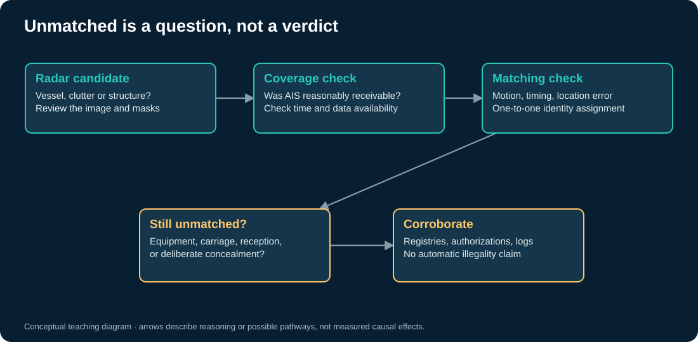

# Dark to which instrument?

“Dark vessel” is useful shorthand only when we specify what is missing. A vessel may be absent from a public tracking product, lack a matching AIS broadcast near an image acquisition, or have a gap in an otherwise visible track. Those are related observations with different denominators.

The [ICEYE article supplied for this project](https://www.iceye.com/blog/dark-vessels-in-northern-europe-and-how-iceyes-satellites-find-them) describes using commercial SAR to complement AIS around Northern Europe. It motivates the sensor-fusion question. It is a vendor account, not the source of the data bundled here. ICEYE imagery has not been downloaded, redistributed, or presented as Sentinel-1 data.

## An investigation tree

First establish whether a candidate is likely a vessel rather than coastline, infrastructure, speckle, or a processing artifact. Then ask whether the public AIS feed had reasonable reception at that location and time. Next examine positional and timing uncertainty. Only after those checks does an unmatched candidate become a question about vessel identity and activity.

Alternative explanations include a vessel without AIS, an equipment fault, a reporting exemption, message collisions, incomplete receiver coverage, delayed data, inaccurate positions, and deliberate disabling. Inferring intent requires independent evidence. Inferring legality additionally requires applicable rules, jurisdiction, authorizations, and a defensible identification. [GFW data caveats](https://globalfishingwatch.org/dataset-and-code-fishing-activity/) and [SAR API definitions](https://api-doc.globalfishingwatch.org/our-apis/documentation/docs/v3/4wings/).

## Why matching is a model

A ship travels between messages. A detection has location uncertainty. A larger matching gate can recover plausible correspondences but also assign the wrong identity. A small gate can leave genuine correspondences unmatched. In a crowded harbor, nearest-neighbor matching can assign one broadcast vessel to several detections unless we enforce a one-to-one constraint.

The matching notebook uses a transparent distance-and-time score with one-to-one assignment. It assumes positions have already been projected to acquisition time. It does not reproduce GFW's production matching model, vessel motion estimation, or SAR azimuth displacement correction.

## Why the percentage is not universal

The publicized finding that much industrial fishing was absent from public tracking comes from a defined study domain, time range, model, and sampling design. It should not become a universal probability that an individual untracked vessel is fishing illegally. [Paolo et al. research and code](https://github.com/GlobalFishingWatch/paper-industrial-activity).

The teaching map preserves empty areas and computes shares only with positive denominators. A high fraction based on very little modeled activity can be unstable. Compare the denominator before comparing the fraction. Geographic groupings in the country table are **EEZ groupings**, not vessel flag states or evidence about the conduct of a country's fleet.

## Exercise: write a defensible sentence

Replace “We found ten illegal ships” with a statement that records the instrument, acquisition time, detection method, match rule, denominator, and remaining uncertainty. Then list the next evidence you would request. [Try the matching experiment](03_matching_and_uncertainty.ipynb), then [look inside a radar detector](04_sar_detection.ipynb).
