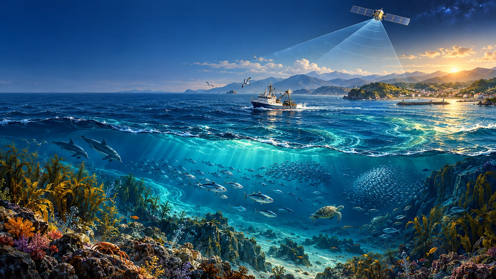

# Ocean Watch

```{raw} html
<div class="hero">
  
  <div class="hero-copy"><span class="eyebrow">A living ocean. A shared health.</span>
  <h2>See the fishing.<br>Question the invisible.<br>Connect the consequences.</h2>
  <p>A field guide and browser laboratory for Global Fishing Watch, dark vessels, Earth observation and One Health.</p>
  <a class="launch" href="https://jltobias.github.io/JupyterLite-Global-Fishing-Watch-and-Dark-Vessels/lab/index.html?path=01_observed_ocean.ipynb">Start exploring ↗</a>
  <a class="launch secondary" href="getting-started.html">Read the field guide →</a></div>
</div>
```

An ocean map can show where activity is visible. It cannot, by itself, tell us who benefits from that activity, how much fish remains, or whether a coastal community can afford nutritious food. This book follows that gap from **observation** to **interpretation** to **decisions**.

We begin with published Global Fishing Watch satellite analysis, rotate its geography in three dimensions, and explore how radar and vessel broadcasts complement each other. Then we follow fisheries into food systems, ecosystem resilience, environmental hazards, and population health.

```{raw} html
<div class="cards">
<div class="card-ocean"><strong>01 / Observe</strong>Map real SAR-derived activity. Ask where coverage ends.</div>
<div class="card-ocean"><strong>02 / Investigate</strong>Experiment with matching gates, radar speckle and uncertain detections.</div>
<div class="card-ocean"><strong>03 / Connect</strong>Trace pathways from ecosystems to nutrition, livelihoods and exposure.</div>
<div class="card-ocean"><strong>04 / Act</strong>Design a study that can support a decision and survive scrutiny.</div>
</div>
```

## Two kinds of evidence, clearly separated

**Observed study data:** the bundled 2017–2021 Sentinel-1 analysis from [Paolo et al. (2024)](https://doi.org/10.1038/s41586-023-06825-8), including modeled fishing classification and AIS matching. These are historical research products, not a live vessel feed. The accompanying map can be explored immediately:

```{raw} html
<iframe class="visual" src="_static/observed-map.html" title="Interactive map of published 2017 to 2021 SAR activity in European waters" loading="lazy"></iframe>
```

<a href="_static/observed-map.html">Open the map in its own window</a>. Source: [Paolo et al. analysis data](https://doi.org/10.6084/m9.figshare.24309475), CC BY 4.0; coastline: Natural Earth, public domain. Colors show sums of per-overpass normalized source-cell activity within 1° bins. These are not fishing hours or counts of unique vessels. Empty areas are not evidence of no activity.

Explore the <a href="_static/observed-globe.html">rotatable observed globe</a>, <a href="_static/ocean-scene.html">conceptual 3D ocean scene</a>, <a href="_static/radar-surface.html">synthetic radar surface</a>, and <a href="_static/stock-scenarios.html">interactive stock scenarios</a>. These standalone figures include their plotting library in the site and require no map-service account.

**Synthetic experiments:** seeded radar scenes, invented vessel positions, ecosystem scenarios, and simple fish-stock models let us change assumptions. Their purpose is to reveal mechanisms. They are labeled in both notebook text and figure titles.

```{admonition} The central rule
:class: important
An unmatched detection does not establish illegal fishing. A tracking gap does not establish deliberate concealment. Fishing activity does not establish catch, stock depletion, food insecurity, or disease.
```

## Choose a journey

| Your question | Begin here | Approximate session |
|---|---|---|
| What does the satellite record show? | [Observed ocean](01_observed_ocean.ipynb) → [3D ocean](02_ocean_in_3d.ipynb) | 45–60 minutes |
| How can a vessel be visible but untracked? | [Dark vessels](dark-vessels.md) → [Matching](03_matching_and_uncertainty.ipynb) → [SAR](04_sar_detection.ipynb) | 60–90 minutes |
| How do I find more satellite or GFW data? | [Satellite catalog](05_satellite_catalog.ipynb) → [GFW workbench](09_gfw_workbench.ipynb) | 45–60 minutes |
| How does ocean activity relate to health? | [One Health](one-health.md) → [Environment](06_environment_and_health.ipynb) → [Food](07_food_and_equity.ipynb) → [Stocks](08_fish_stocks.ipynb) | 90–120 minutes |

No account is needed for the bundled exercises. First use of the browser lab downloads its Python runtime and packages. The published book and browser lab bundle their plotting JavaScript locally. Exported notebooks opened in a separate desktop Jupyter environment use the Plotly CDN. See [getting started](getting-started.md) for accessibility, saving work, and troubleshooting.

Independent educational project; no affiliation or endorsement by Global Fishing Watch, ICEYE, WHO, FAO, ESA, or Microsoft is implied. Cover: AI-generated conceptual illustration, not satellite evidence. See [sources and attribution](sources.md).
