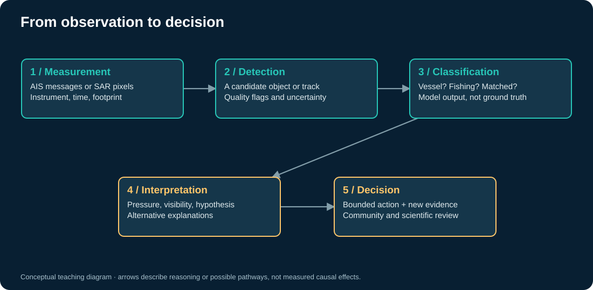

# What can we actually observe?

Imagine three people watching the same sea. One hears radio messages. One photographs the surface. One measures microwave energy returning from it. Their maps disagree because their instruments observe different things.

## AIS: a broadcast with a history

Automatic Identification System messages contain a vessel's reported identity and navigation information. Global Fishing Watch combines tracking and other information to classify vessels and infer **apparent fishing activity** from movement. It is an inference about behavior, measured as estimated fishing hours; it is not a landing declaration or direct measurement of catch. [GFW methodology](https://globalfishingwatch.org/dataset-and-code-fishing-activity/).

Reception, carriage requirements, vessel size, device behavior, and data-sharing agreements shape what becomes visible. Small-scale fishers are especially easy to underrepresent in an AIS-centered view. A more complete map therefore needs complementary sources and local knowledge. [GFW vessel identity and coverage](https://globalfishingwatch.org/datasets-and-code-vessel-identity/).

## SAR: a detection without a broadcast

Synthetic aperture radar actively illuminates the surface with microwaves. Metal structures, geometry, sea conditions, polarization, and viewing angle influence the return. SAR can acquire images at night and through cloud, but wave clutter, rain effects, interference, shoreline structures, and small or low-reflectivity vessels complicate detection. A bright pixel is an observation; a vessel is an interpretation. [Sentinel-1 processing](https://developers.google.com/earth-engine/guides/sentinel1).

The bundled study uses Sentinel-1 imagery, deep learning, and AIS matching over 2017–2021. Its output is already a processed research product. Our map is several steps removed from the original radar pixels. [Study data and definitions](https://doi.org/10.6084/m9.figshare.24309475).

## Optical, night lights, and environmental context

Optical imagery can provide shape and wake context but depends on illumination and cloud conditions. Night-light detections can reveal brightly lit activity, including some fishing operations, while missing vessels that use little light. Neither is a census. [GFW VIIRS guide](https://globalfishingwatch.org/wp-content/uploads/Understanding-VIIRS-Data.pdf).

Sea-surface temperature, chlorophyll, oxygen, currents, bathymetry, and coastal habitats help formulate ecological questions. Their temporal and spatial supports rarely match vessel observations exactly. A monthly environmental mean can smooth away a short hazardous event. Satellite chlorophyll is an ocean-color estimate, not a direct measurement of a harmful species or toxin. [NASA ocean color context](https://www.earthdata.nasa.gov/s3fs-public/2024-07/SNWG%20Water%20Quality%20Fact%20Sheet.pdf).

## Keep the unit attached

| Quantity | Meaning | Does not directly measure |
|---|---|---|
| Apparent fishing hours | Time classified as apparent fishing | Catch, abundance, legality |
| Radar detection | An object-like return in an acquisition | A unique vessel or fishing event |
| Normalized study activity | Expected detections per overpass in a cell | A simultaneous global fleet census |
| Unmatched fraction | Unmatched component / total modeled fishing component | Fraction of illegal vessels |
| Stock biomass | Estimated population mass for a defined stock | Human access to seafood |

In [notebook 01](01_observed_ocean.ipynb), compare counts of source cells, imagery coverage, and activity. Ask: would the same geography look different if it were sampled equally often, if cell areas were equal, or if every vessel carried a working transmitter?
