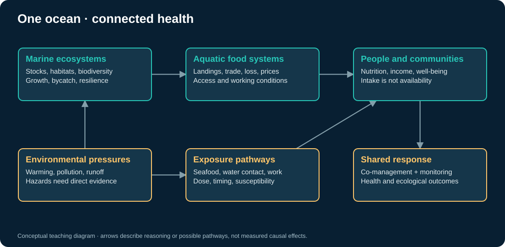

# One ocean, many pathways to health

One Health treats people, animals, plants, and ecosystems as interdependent and asks different sectors to work together. That framing helps us connect a vessel observation to a much larger system without pretending the connection is already a measured causal effect. [WHO One Health definitions and principles](https://www.who.int/publications/m/item/one-health-definitions-and-principles).

## Food and nutritional security

A landing can supply nutrient-rich food, wages, trade income, or several of these. Its contribution to population health depends on species, edible yield, spoilage, distribution, price, household access, and dietary substitution. Export volume and local nutrition can move in different directions. The food notebook therefore separates **catch**, **local retention**, **edible availability**, and **availability per person**.

These calculations are accounting scenarios. They do not diagnose malnutrition or establish dietary adequacy. Fish-consumption benefits and risks vary with species, contaminants, population, and diet; both deserve attention. [FAO/WHO review of risks and benefits](https://www.who.int/publications/i/item/9789240096882).

## Ecosystem and animal health

Fishing mortality, bycatch, habitat disturbance, and climate stress can affect marine populations. Their consequences depend on the species, gear, habitat, and management system. A fleet activity hotspot is a place to formulate a question about pressure; a stock assessment requires additional catch, survey, biological, and assessment information. FAO's 2025 marine resource assessment provides a useful example of a stock-based assessment with explicitly defined denominators. [FAO assessment](https://www.fao.org/newsroom/detail/fao-releases-the-most-detailed-global-assessment-of-marine-fish-stocks-to-date).

## Environmental exposure and disease

Warming coastal waters can favor some *Vibrio* hazards, but water temperature alone does not identify bacteria or estimate infection probability. Salinity, exposure routes, host susceptibility, healthcare access, and surveillance also matter. Here, temperature is a contextual indicator used to generate hypotheses; it is not a diagnostic map. [CDC warming-coastal-waters advisory](https://www.cdc.gov/han/2023/han00497.html).

Mercury illustrates another pathway: environmental contamination, transformation, food-web accumulation, seafood consumption, and human exposure. Vessel observations do not measure contaminant concentration. That requires sampling and a carefully defined exposure assessment. [WHO mercury factsheet](https://www.who.int/en/news-room/fact-sheets/detail/mercury-and-health).

Mosquito-borne disease has a different pathway: coastal settlements, standing-water habitats, vector ecology, and human exposure. It should not be inferred from an offshore vessel hotspot. Antimicrobial resistance questions similarly need microbiological and antimicrobial-use data; fishing effort cannot establish resistance. These are candidate One Health study questions, not outputs of these notebooks.

## Workers and communities are part of the system

Crew safety, time at sea, working conditions, access to care, and coastal livelihoods belong in the study design. Communities should help decide which outcomes matter and how results are interpreted. A surveillance intervention can improve transparency while creating costs or risks for small-scale fishers. Public reporting should avoid identifying vulnerable people or making unsupported accusations.

## From pathway to study

Choose a single outcome and a plausible chain of mechanisms. Draw the time order, identify confounders, and name the measurements each arrow requires. For example: a management intervention → fishing mortality → stock availability → local edible supply → household intake. Prices, trade, climate, wealth, and dietary substitution may alter that chain. A strong causal story is a starting point for data collection, not a substitute for it.

Explore [environmental confounding](06_environment_and_health.ipynb), [food distribution](07_food_and_equity.ipynb), and [stock dynamics](08_fish_stocks.ipynb). Each exercise keeps observed evidence separate from a hypothetical mechanism.
